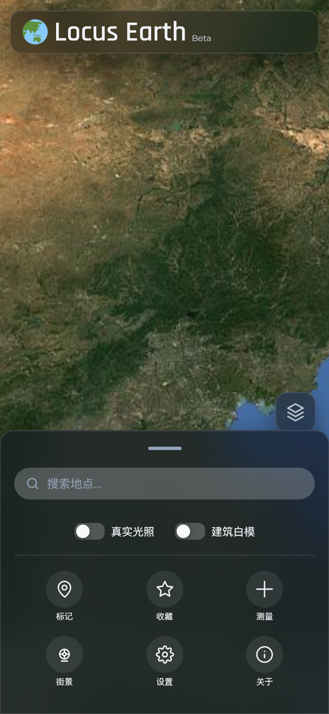
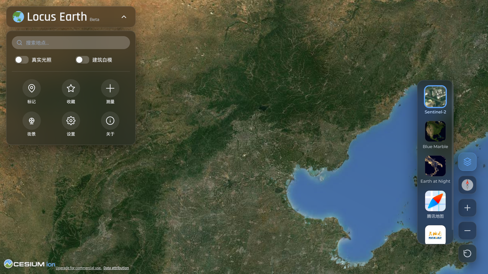

# Locus Earth

🌐 语言 / Language:
<a>简体中文</a> | <a href="README-EN.md">English</a>

---

---

---

> 基于 Cesium 的 3D 地球，打开浏览器即可使用，无需安装或注册
>
> **[GitHub Pages](https://zhunemo.github.io/locus-earth/)** · **[Cloudflare Pages](https://locus-earth.pages.dev)**

---

## 目录
- [项目简介](#-项目简介)
- [核心功能](#-核心功能)
- [界面预览](#-界面预览)
- [使用说明](#-使用说明)
- [设置与自定义](#-设置与自定义)
- [Android 版（APK）](#-android-版apk)
- [技术栈与致谢](#-技术栈与致谢)
- [API Key 注意事项](#-api-key-注意事项)
- [项目信息](#-项目信息)

---

## 🌍 项目简介
**Locus Earth** 是一个开源的 Web 3D 地球应用，交互方式参考 Google Earth。它用原生 ES Modules 编写，没有构建步骤，打开网页就能运行，也可以装到桌面或手机当 PWA 使用。

代码以 MIT 许可开源，**网页端和 Android 壳工程都在本仓库里**（壳在 [`androidapk/`](./androidapk/)，见 [Android 版](#-android-版apk)）。网页本身不需要安装；APK 只是另一种打开方式，你也可以自行构建、修改和分发。

---

## ✨ 核心功能

**浏览**
- 3D 地形与全球卫星影像，叠加全球 3D 建筑（OpenStreetMap 数据）。
- 底图切换：Sentinel-2、Blue Marble、夜间灯光、天地图卫星、腾讯地图等。

**工具**
- 距离与面积测量，折线和多边形都贴合地形。
- 标记与收藏夹，数据保存在浏览器本地，支持导入导出。
- 地点搜索：输入地名直接定位。

**区域联动**
- 进入丹佛、华盛顿 D.C.、悉尼等覆盖区，自动切换到高精度城市建模。
- 进入中国大陆，功能栏自动出现「街景」按钮，点击地图可跳转 360° 全景。

**外观与交互**
- 昼夜光照（太阳 / 月亮，可调时间）、建筑白模开关；深浅主题可跟随系统。
- 指南针、恢复俯仰角、可拖动的悬浮工具条，桌面和移动端都已适配。
- Google 3D 模式：网络能访问 Google 时，可加载 Google 的 3D Tiles。该数据是 Cesium ion 上的演示资产，可能被限流或下架。

---

## 📱 界面预览
**移动端：**

**桌面端：**

*截图不一定实时更新，最新界面请访问网页。*

---

## 🧭 使用说明
- **标记 / 街景 / 测量三者互斥**：同一时刻只能激活一个，切换时会自动关闭另一个，避免点击冲突。
- 街景跳转需要联网，PWA 离线时不可用。
- 移动端底部托盘可上滑展开，点击手柄收合。

---

## ⚙️ 设置与自定义
功能栏「设置」进入 `/settings.html`，可调整明暗主题（跟随系统 / 手动）、地形加载、路网叠加与缓存。

**缓存与离线**：缓存全部由 [`sw.js`](./sw.js) 管，分三层。

| 层 | 缓存名 | 策略 |
|---|---|---|
| 应用外壳（HTML / CSS / JS / 图标） | `locus-earth-app-cache-<版本>` | 缓存优先 + 后台更新，重复进入几十毫秒出页面 |
| Cesium 引擎 | `locus-earth-cesium-<引擎版本>` | 缓存优先，升级引擎时整代淘汰 |
| ion 资产接口（`/v1/assets/<id>/endpoint`） | 与引擎同一个缓存 | 45 分钟内缓存优先 + 后台换新，过期才网络优先、失败退回旧的那份——拿不到它 Cesium 建不出影像图层，缓存了瓦片也是黑的 |
| 底图瓦片 | `locus-earth-tiles-v1` | 缓存优先且命中后**不再回源**，浏览过的区域断网也能看；超 2400 片按先进先出裁剪 |
| 开关状态 | `locus-earth-flags-v1` | 几十字节，只存「缓存瓦片」的开 / 关；SW 读不到 localStorage，只能这么带 |

两个值得记下来的点：

1. **Service Worker 拦得到 XHR**。「SW 拦不到 XHR」是常见误传——拦不到的是 WebSocket 和
   EventSource。Chromium / Android WebView 里，纯 XHR 的响应同样会进 Cache Storage，
   所以 Cesium 用 XHR 取瓦片完全不影响缓存。早期版本曾据此去覆写
   `Resource._Implementations.loadWithXhr`，实测后已删除：那层包装只会增加升级引擎时的
   风险，而且开关得在页面和 SW 各写一遍——正是「关掉开关仍然在缓存」的根源。
2. 瓦片回源时显式带 `cache: 'no-store'`，让浏览器不要在自己的 HTTP 缓存里再存一份。
   否则同一张图在磁盘上存两遍，而 HTTP 那份网页既查不到也删不掉——用户点「清除瓦片缓存」
   后觉得"占用没降"，多半就是它在作祟。

设置页的「缓存地图瓦片」（默认开）现在由 `sw.js` 执行：关掉之后瓦片请求整条放行，
不读缓存、不写缓存、也不碰 HTTP 缓存，每次真从网络取。「清除瓦片缓存」删掉整个瓦片缓存；
系统显示的存储占用是懒统计的，可能延迟一会儿才更新。

**渲染与性能**：3D 场景关闭了 WebGL 自带的 MSAA，改用 FXAA 后处理抗锯齿。
原因是 MSAA 在移动端代价偏高：GPU 不支持硬件 MSAA 的设备上，Chromium 可能退化成
软件 MSAA（每像素多次采样，填充率明显下降），支持的设备也要额外付出带宽和显存；
而 FXAA 只是一次全屏 pass，不额外占用显存。两个开关都在 `js/viewer.js` 里
（`contextOptions.webgl.antialias` 和 `scene.postProcessStages.fxaa.enabled`），
低端机上如果觉得卡，把 FXAA 那行改成 `false` 即可，没有其它影响。

---

## 📱 Android 版（APK）

本项目不是原生 App：网页是主体，Android 版只是一个原生 WebView 外壳 ——
它把网页全屏装进一个没有地址栏的窗口里，页面内容仍然从线上实时加载。

| | |
|---|---|
| **获取** | 从 [Releases](https://github.com/ZhuNemo/locus-earth/releases) 下载 APK；或自行构建（方法见下方折叠说明） |
| **包名 / 要求** | `dev.locusearth.app` · Android 7.0（API 24）及以上 |
| **壳的职责** | 全屏无地址栏 · 白名单域名留在壳内 · 其余链接交给系统浏览器 · 首次启动说明「这是网页应用」 |
| **源码位置** | [`androidapk/`](./androidapk/)（独立 Gradle 工程，与主项目同为 MIT 许可） |

**网页更新后不需要重装 APK。** 壳里没有任何业务逻辑，网页一改，所有已安装用户立即生效。
只有换图标、改白名单域名、改包名这类壳自身的事才需要重新出包。

<b>点开查看：自己构建 APK / 签名说明</b>

三种方式任选：

| 方式 | 怎么做 |
|---|---|
| GitHub Actions（推荐） | 仓库 `Actions` → `Build Android APK` → `Run workflow`；或推一个 `v*` tag。产物在 Artifacts 里 |
| 命令行 | `cd androidapk && ./gradlew :app:assembleRelease`（Windows 用 `gradlew.bat`） |
| Android Studio | 打开 **`androidapk/`** 目录（不是仓库根）→ `Build → Build APK(s)` |

签名是可选的：CI 上配了密钥就出正式签名包，**没配也能构建成功**（自动回退 debug 签名，能装能跑、不能上架）。
Fork 后要发布自己的版本，请按 [`androidapk/README.md`](./androidapk/README.md) 第六节
生成自己的 keystore，**不要复用他人密钥**。

安装时需在系统设置里允许「安装未知来源应用」。用自备密钥签名的包，
后续更新必须用**同一个密钥**签名，否则系统会拒绝覆盖安装。

完整的构建、签名、换图标、加白名单域名、Cloudflare Pages 部署排除等说明，
见 **[`androidapk/README.md`](./androidapk/README.md)**。

---

## 🚀 技术栈与致谢
| | |
|---|---|
| **引擎** | CesiumJS 1.118 |
| **架构** | 原生 ES Modules，零构建步骤 |
| **形态** | PWA（Service Worker + Manifest） |
| **AI 辅助** | DeepSeek、GitHub Copilot、Hunyuan |

**数据来源**：[Cesium ion](https://ion.cesium.com/) · [OpenStreetMap](https://www.openstreetmap.org/) · [Natural Earth](https://www.naturalearthdata.com/) · [天地图](https://www.tianditu.gov.cn/) · [腾讯地图](https://map.qq.com/)

**特别致谢**：腾讯街景借助社区维护的第三方查看器 [qq-map](https://qq-map.netlify.app/) 打开全景（非腾讯官方服务）。坐标转换见 [js/coord-transform.js](https://github.com/ZhuNemo/locus-earth/blob/main/js/coord-transform.js)（WGS-84 ↔ GCJ-02 双向）。

---

## 📝 API Key 注意事项

<b>点开查看（Fork / 自部署必读）</b>

项目内置的 Cesium、腾讯地图、天地图密钥**都设了域名白名单**，仅供本项目演示。

Fork 或部署到自己的域名 / 本地，请改 [js/config.js](https://github.com/ZhuNemo/locus-earth/blob/main/js/config.js)，换成自己申请的免费 Key，并在控制台设置自己的白名单。请不要用别人的密钥消耗其配额。

申请入口：
- [Cesium Ion Access Token](https://ion.cesium.com/tokens)
- [腾讯地图 API](https://lbs.qq.com/dev/console/application/mine)
- [天地图 API](https://cloudcenter.tianditu.gov.cn/center/development/myApp)

---

## 💡 项目信息
| | |
|---|---|
| **开始时间** | 2026-07-04 |
| **维护** | 个人项目，业余开发，不定期更新 |
| **当前版本** | 7.3 |

---

© Zhu Nemo · [GitHub](https://github.com/ZhuNemo) · [Dev.to](https://dev.to/zhunemo)
